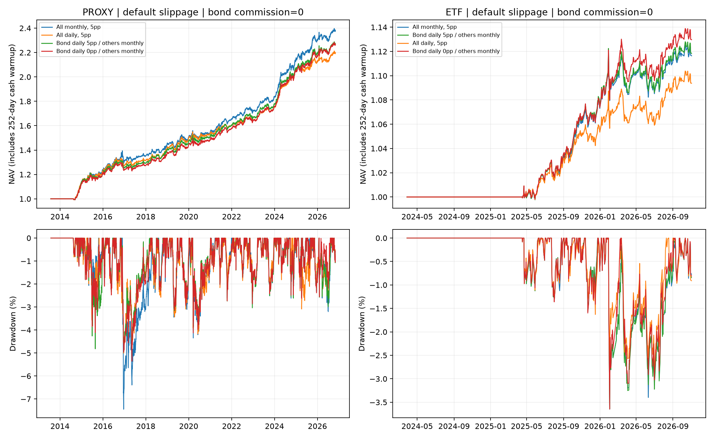

# 国债日频、其他资产月频：当前定时策略的长周期研究

> 后续归因补充（2026-11-02）：原长期代理的CU0最小1单位使铜仓位在0与1间跳变，显著放大国债日频的资金与阈值路径差。只细化铜计价单位、保持收益率和信号不变后，default国债日频5pp/0pp相对月频的期末差额由约−2.21/−2.29万元缩至−0.48/−0.10万元。下列原指标保留，但不能将差距全部归因于国债择时或费用；详见[收益差归因与月频优化报告](../../monthly_frequency_attribution/20261102/report.md)。

日期：2026-11-02。研究范围由用户指定，属于定向历史模拟，没有自主选题、参数择优或候选验收。

**可以实现混合频率，但“免手续费”不足以推出每日贴合目标会提高长期收益。** 在现有长期代理篮子中，国债日频保留5个百分点阈值可明显降低完整样本回撤，同时牺牲约0.40—0.42个百分点年化收益；取消阈值没有进一步改善完整样本收益，压力滑点下的起点优势也不稳定。实际ETF短样本对国债无阈值日频较有利，但建仓后只有375个交易日，不能替代长期证据。

本研究交付报告和独立复现入口，没有更改定时任务、正式策略配置或账户状态。若主要目标是降低回撤，可将保留阈值的混合方案作为取舍；若主要目标是提高长期收益，本次证据不足以支持仅因免手续费而改成无阈值每日调仓。

## 当前任务与研究问题

Windows任务 `Strategy_ES252d_Live_Cycle` 通过 WSL 的 `/root/run_live.sh` 调用 `platform/scripts/run_live_cycle.py cycle`，配置为 `configs/capital_100k/es_252d_fhs_stepdown_trend_200k_v2_563020_511130.yaml`。只将任务配置路径用于研究，未运行实盘环路或发送通知。

当前配置是**所有资产每日检查**，不是全部月频：`rebalance_frequency: daily`，目标与现有持仓任一资产偏差超过 `rebalance_threshold: 0.05` 才生成整组目标；执行层还有 `weight_tolerance: 0.02`。每日检查并不等于每日必有成交。

策略保留252日回看、252日最小收益样本、95% FHS-ES、`fhs_decay: 0.94`、8%波动率上限、200日SMA下方降到原权重25%的过滤。尽管配置名有stepdown，实际参数为 `trend_filter_mode: binary` 加 `trend_filter_scale_down: 0.25`。风险预算依次为股票15%、红利15%、国债30%、黄金15%、豆粕12.5%、有色12.5%。没有新增信号或搜索参数。

问题限定为：沿用该风险目标，允许国债每天根据截至前一交易日的信息调整，其他资产只按月末信息调整，是否改善长期收益、风险及交易负担？基准为相同资产、相同成本的全月频方案，同时保留现行全日频对照。

## 标的、价格与样本

| 实际ETF（`asset_type: etf`） | 长期代理及`asset_type` | 代理限制 |
| --- | --- | --- |
| 510300 沪深300ETF | 000300 沪深300，`index` | 发布价格指数，不完全含股票分红再投资 |
| 563020 红利低波ETF | 000015 上证红利，`index` | 沿用仓库代理，不能精确复制红利低波选股 |
| 511130 30年国债ETF | CBA21801 中债30年国债财富，`index` | 同久期资产代理，非该ETF的精确标的指数 |
| 518880 黄金ETF | 仍用518880，`etf` | 没有另造更早黄金价格历史 |
| 159985 豆粕ETF | M0 连续期货，`futures` | 不含ETF实际展期、费用和跟踪路径 |
| 159980 有色期货ETF | CU0 沪铜连续期货，`futures` | 单一铜合约代理，非有色篮子的精确复制 |

511130的官方业绩基准为上证30年期国债指数，不能把CBA21801写成它的精确跟踪标的。[基金2026年一季报](https://www.sse.com.cn/disclosure/fund/announcement/c/new/2026-04-22/511130_20260422_IYHJ.pdf)

ETF信号用后复权收盘序列；成交和估值用原始开盘/收盘，显式处理拆分、分红应收和派息。代理权益采用发布价格，国债采用财富指数，连续期货采用本地连续报价；CBA21801缺少真实开盘，按平台规则用当日指数收盘代替。它仍使用前一交易日信号，不使用当日价格计算当日目标。

所有11个所需标的最新本地日期均为2026-11-02，通过7日新鲜度与末日对齐检查。指数/期货本次通过 `sync_index_benchmark_data.py --no-sync-pit-bonds` 同步；ETF为当前本地平台行情。来源为平台Finshare、Sina和中债官方链。

历史日历也取各篮子六资产报价日期的交集，避免国债周末估值日成为虚构交易日，不填补缺失行情。长期代理共3217日，起止2013-07-29—2026-11-02；共同起点以后各源删除的非共同日期行数为 `000300:6 / 000015:6 / CBA21801:97 / 518880:6 / M0:6 / CU0:7`。实际ETF共628日，起止2024-03-28—2026-11-02，无内部日历差异。清洗只写研究临时快照，原始行情保留。

所有方案统一20万元、无初始持仓、无杠杆。252个共同收益样本预热后建仓：长期代理首次成交2014-08-15，ETF首次成交2025-04-16。主表的年化/波动/Sharpe含预热现金段；另列“建仓后年化”，敏感性使用建仓后指标。现金不计利息。平台Sharpe口径为年化复合收益除以年化波动，无风险利率取0；不是日超额收益均值除波动。

## 四个方案与成本

| 标识 | 月末整组目标 | 月内国债 | 月内其他资产 |
| --- | --- | --- | --- |
| `monthly` | 偏差超过5pp才触发 | 不新增信号 | 不新增信号 |
| `daily` | 每日均按整组5pp检查 | 受整组触发影响 | 受整组触发影响 |
| `mixed5` | 整组5pp检查 | 每天检查，国债自身偏差超过5pp才触发 | 保持份额 |
| `mixed0` | 整组5pp检查 | 每天检查，不设策略偏差阈值和2pp执行容忍带 | 保持份额 |

所有方案首次建仓采用相同预热规则。月末未触发整组调仓时，混合方案仍可单独发出国债目标；已有月末订单的未完成重试沿用平台机制。月内国债只能与现金交换，加仓不能卖出其他资产融资，因此不保证每天达到理论国债权重。手续费、开盘跳空和整手都可能形成残差。`mixed0`不是无限细分的日复权模拟，实际ETF仍保留100份整手和现金购买力限制；其余方案保留原2pp执行容忍带。

除单列的 `charged_daily` 现行收费对照外，国债交易费率和最低费均为0；其他资产保持万二、每笔最低5元。这里接受用户的零佣金前提作为情景假设。交易所公开表确认债券ETF暂免的是经手费，该规定本身不能代替具体券商的佣金约定。[上交所收费一览表](https://www.sse.com.cn/services/tradingservice/charge/ssecharge/)

`default` 的普通/商品类滑点为2/6bps，`stress`为10/30bps，买卖双向分别施加。国债仍有2/10bps滑点。`stress`是固定bps压力场景，没有新增动态参与率模型。信号在T日收盘后形成，最早T+1开盘执行；单独保留挂单、现金上限、整手、拒单和交易记录。发布指数和期货连续报价只作虚拟买卖研究，不代表实际容量、保证金、换月成本或可执行组合。

## 长期代理完整窗口

| 方案 | 滑点 | 累计收益 | 年化收益 | 建仓后年化 | 年化波动 | Sharpe | 最大回撤 | 年化换手 | 成交/订单/拒单 |
| --- | --- | ---: | ---: | ---: | ---: | ---: | ---: | ---: | --- |
| 全资产月频5pp | default | 137.97% | 7.03% | 7.65% | 4.32% | 1.6276 | -7.45% | 105.74% | 330/332/2 |
| 全资产月频5pp | stress | 131.87% | 6.81% | 7.41% | 4.31% | 1.5805 | -7.39% | 105.30% | 331/333/2 |
| 国债日频5pp＋其他月频 | default | 126.93% | 6.63% | 7.22% | 4.20% | 1.5794 | -5.13% | 133.08% | 412/414/2 |
| 国债日频5pp＋其他月频 | stress | 120.42% | 6.39% | 6.95% | 4.17% | 1.5339 | -5.41% | 134.73% | 416/418/2 |
| 国债日频0pp＋其他月频 | default | 126.53% | 6.62% | 7.20% | 4.18% | 1.5817 | -5.36% | 186.94% | 2906/2908/2 |
| 国债日频0pp＋其他月频 | stress | 115.15% | 6.19% | 6.73% | 4.17% | 1.4839 | -5.63% | 188.32% | 2911/2913/2 |
| 全资产日频5pp | default | 119.66% | 6.36% | 6.92% | 4.07% | 1.5614 | -5.01% | 270.94% | 1040/1040/0 |
| 全资产日频5pp | stress | 103.91% | 5.74% | 6.24% | 4.03% | 1.4233 | -5.41% | 267.92% | 1040/1040/0 |

相对月频，`mixed5`在default/stress的年化差为约−0.40/−0.42个百分点，最大回撤改善约2.32/1.98个百分点。完整窗口里月频收益和Sharpe最高；全日频回撤更小，代价是更高换手与更低收益。

`mixed0`相对`mixed5`，default年化约低0.01个百分点，stress低0.20个百分点；国债成交从204/205笔增至2698/2699笔。零佣金并没有消除滑点代价。这个交易次数差也反映代理国债按1单位取整，与真实ETF100份整手不同。

## 实际ETF共同历史

| 方案 | 滑点 | 累计收益 | 年化收益 | 建仓后年化 | 年化波动 | Sharpe | 最大回撤 | 年化换手 | 成交/订单/拒单 |
| --- | --- | ---: | ---: | ---: | ---: | ---: | ---: | ---: | --- |
| 全资产月频5pp | default | 11.65% | 4.53% | 7.68% | 4.06% | 1.1146 | -3.65% | 83.96% | 48/49/1 |
| 全资产月频5pp | stress | 10.87% | 4.24% | 7.18% | 4.03% | 1.0510 | -3.61% | 82.28% | 47/48/1 |
| 国债日频5pp＋其他月频 | default | 11.85% | 4.60% | 7.82% | 4.06% | 1.1345 | -3.64% | 104.69% | 52/53/1 |
| 国债日频5pp＋其他月频 | stress | 11.07% | 4.31% | 7.31% | 4.03% | 1.0683 | -3.61% | 104.89% | 52/53/1 |
| 国债日频0pp＋其他月频 | default | 12.97% | 5.02% | 8.54% | 4.15% | 1.2115 | -3.65% | 124.32% | 72/73/1 |
| 国债日频0pp＋其他月频 | stress | 12.14% | 4.71% | 8.00% | 4.15% | 1.1343 | -3.70% | 126.76% | 74/75/1 |
| 全资产日频5pp | default | 9.38% | 3.67% | 6.21% | 3.60% | 1.0196 | -2.83% | 215.75% | 147/147/0 |
| 全资产日频5pp | stress | 8.12% | 3.19% | 5.38% | 3.63% | 0.8772 | -3.06% | 218.10% | 148/148/0 |

在该短样本里，`mixed0`相对月频的完整窗口年化提高约0.50/0.48个百分点，建仓后年化提高约0.86/0.82个百分点，最大回撤接近。`mixed5`相对月频的改善仅约0.08个百分点/年。混合方案相对现行全日频更好，不能全部归因于国债日频；将其他资产改为月频本身已显著降低交易频率。

实际ETF建仓后只有375个交易日。原始数据覆盖约两年半，不等于已投资两年半；本结果不能说明真实策略已经历完整利率周期。

## 相同运行窗口的代理与ETF诊断

下面将代理也从2024-03-28重新预热，首次成交同为2025-04-16。这用于检查方向差异，不跨篮子排名。

| 方案 | 滑点 | 累计收益 | 年化收益 | 建仓后年化 | 年化波动 | Sharpe | 最大回撤 | 年化换手 | 成交/订单/拒单 |
| --- | --- | ---: | ---: | ---: | ---: | ---: | ---: | ---: | --- |
| 全资产月频5pp | default | 6.28% | 2.48% | 4.18% | 3.24% | 0.7647 | -3.26% | 84.43% | 57/58/1 |
| 全资产月频5pp | stress | 5.76% | 2.28% | 3.83% | 3.21% | 0.7101 | -3.39% | 81.80% | 53/54/1 |
| 国债日频5pp＋其他月频 | default | 6.09% | 2.40% | 4.05% | 3.23% | 0.7441 | -3.15% | 106.16% | 61/62/1 |
| 国债日频5pp＋其他月频 | stress | 5.60% | 2.21% | 3.73% | 3.22% | 0.6882 | -3.28% | 102.99% | 55/56/1 |
| 国债日频0pp＋其他月频 | default | 7.71% | 3.03% | 5.12% | 3.31% | 0.9150 | -2.58% | 132.84% | 365/366/1 |
| 国债日频0pp＋其他月频 | stress | 6.96% | 2.74% | 4.62% | 3.32% | 0.8264 | -2.60% | 132.80% | 363/364/1 |
| 全资产日频5pp | default | 6.19% | 2.44% | 4.12% | 2.88% | 0.8494 | -2.51% | 169.39% | 158/158/0 |
| 全资产日频5pp | stress | 4.72% | 1.87% | 3.15% | 2.88% | 0.6486 | -2.84% | 167.93% | 157/157/0 |

同窗代理的`mixed0`也改善月频，但绝对收益明显不同，表明长期代理并非真实ETF的无误差延伸；红利、债券指数和商品篮子映射会影响结论。

## 每两个自然月更换运行起点

从每个篮子的共同首日生成双月锚点，取当日或之后首个共同交易日，终点统一2026-11-02。每个起点重新预热252个收益，不继承早期持仓或信号状态。运行全部80个代理起点、16个ETF起点及两种成本；其中建仓后双方均至少126日的配对纳入稳健性展示，分别为71和7个。其余短历史/无成交运行仍在证据中，不拿来支持优势。

表中胜出相对同起点、同篮子、同成本的`monthly`，不同起点高度重叠，不是独立统计样本。“配对差中位数”不等于两列中位数相减。

| 篮子 | 方案 | 滑点 | 有效起点 | 建仓后年化中位数 | 建仓后Sharpe中位数 | 配对Sharpe差中位数 | 收益胜出 | Sharpe胜出 | 最差回撤 |
| --- | --- | --- | ---: | ---: | ---: | ---: | ---: | ---: | ---: |
| 长期代理 | 全资产月频5pp | default | 71 | 6.81% | 1.6671 | +0.0000 | 0/71 | 0/71 | -7.45% |
| 长期代理 | 全资产月频5pp | stress | 71 | 6.53% | 1.5878 | +0.0000 | 0/71 | 0/71 | -7.48% |
| 长期代理 | 国债日频5pp＋其他月频 | default | 71 | 6.89% | 1.6879 | -0.0134 | 28/71 | 28/71 | -5.24% |
| 长期代理 | 国债日频5pp＋其他月频 | stress | 71 | 6.53% | 1.6026 | -0.0254 | 22/71 | 29/71 | -5.48% |
| 长期代理 | 国债日频0pp＋其他月频 | default | 71 | 7.00% | 1.6870 | +0.0265 | 64/71 | 58/71 | -5.38% |
| 长期代理 | 国债日频0pp＋其他月频 | stress | 71 | 6.56% | 1.5893 | -0.0048 | 39/71 | 31/71 | -5.72% |
| 长期代理 | 全资产日频5pp | default | 71 | 6.25% | 1.5775 | -0.1054 | 3/71 | 6/71 | -5.94% |
| 长期代理 | 全资产日频5pp | stress | 71 | 5.55% | 1.4035 | -0.2319 | 1/71 | 2/71 | -6.67% |
| 实际ETF | 全资产月频5pp | default | 7 | 5.39% | 0.9317 | +0.0000 | 0/7 | 0/7 | -3.74% |
| 实际ETF | 全资产月频5pp | stress | 7 | 5.01% | 0.8621 | +0.0000 | 0/7 | 0/7 | -3.79% |
| 实际ETF | 国债日频5pp＋其他月频 | default | 7 | 5.65% | 0.9827 | +0.0394 | 7/7 | 6/7 | -3.74% |
| 实际ETF | 国债日频5pp＋其他月频 | stress | 7 | 4.97% | 0.8502 | +0.0006 | 4/7 | 4/7 | -3.79% |
| 实际ETF | 国债日频0pp＋其他月频 | default | 7 | 6.88% | 1.1534 | +0.1413 | 7/7 | 7/7 | -3.74% |
| 实际ETF | 国债日频0pp＋其他月频 | stress | 7 | 6.29% | 1.0492 | +0.1213 | 7/7 | 7/7 | -3.79% |
| 实际ETF | 全资产日频5pp | default | 7 | 4.54% | 0.9072 | -0.1132 | 0/7 | 1/7 | -3.11% |
| 实际ETF | 全资产日频5pp | stress | 7 | 3.69% | 0.7248 | -0.1699 | 1/7 | 1/7 | -3.46% |

长期排序随起点改变：`mixed0`在default下64/71个起点收益更高、58/71个Sharpe更高，虽然完整窗口不胜月频，说明早期完整样本与后续起点的结论不同。其配对建仓后年化差中位数为+0.13个百分点；压力滑点缩至约+0.01个百分点，Sharpe仅31/71个胜出，配对Sharpe差中位数−0.0048，范围约[−0.1356,+0.3632]，不支持稳定优势。

`mixed5`的长期default/stress配对Sharpe差中位数为−0.0134/−0.0254；收益仅28/71、22/71个起点胜过月频。它的主要价值是降低部分窗口回撤，而非普遍提高风险调整后收益。相对月频的最大回撤差在少数起点仍为负，不能声称每个起点都降低回撤。

ETF的`mixed0`在两成本各7/7个有效起点收益与Sharpe更高，配对建仓后年化差中位数为+0.86/+0.82个百分点；`mixed5`改善较弱，压力场景只有4/7个收益和Sharpe胜出。7个重叠起点集中在同一近年市场环境，样本较短。

## 费用、现金和执行诊断

| 篮子 | 方案 | 滑点 | 累计手续费（元） | 国债成交数 | 平均现金权重 | 最大待执行意图 | 国债目标现金不足日数 |
| --- | --- | --- | ---: | ---: | ---: | ---: | ---: |
| 长期代理 | 全资产月频5pp | default | 1377.73 | 102 | 29.94% | 6 | 0 |
| 长期代理 | 全资产月频5pp | stress | 1371.17 | 102 | 30.28% | 6 | 0 |
| 长期代理 | 国债日频5pp＋其他月频 | default | 1252.22 | 204 | 31.22% | 6 | 154 |
| 长期代理 | 国债日频5pp＋其他月频 | stress | 1272.43 | 205 | 31.24% | 6 | 114 |
| 长期代理 | 国债日频0pp＋其他月频 | default | 1249.18 | 2698 | 30.40% | 6 | 143 |
| 长期代理 | 国债日频0pp＋其他月频 | stress | 1261.00 | 2699 | 30.37% | 6 | 129 |
| 长期代理 | 全资产日频5pp | default | 4132.13 | 324 | 31.10% | 6 | 0 |
| 长期代理 | 全资产日频5pp | stress | 4058.56 | 325 | 30.93% | 6 | 0 |
| 实际ETF | 全资产月频5pp | default | 191.04 | 10 | 53.56% | 6 | 0 |
| 实际ETF | 全资产月频5pp | stress | 191.02 | 9 | 53.59% | 6 | 0 |
| 实际ETF | 国债日频5pp＋其他月频 | default | 186.06 | 15 | 53.91% | 6 | 28 |
| 实际ETF | 国债日频5pp＋其他月频 | stress | 186.05 | 15 | 53.85% | 6 | 28 |
| 实际ETF | 国债日频0pp＋其他月频 | default | 196.04 | 33 | 53.46% | 6 | 27 |
| 实际ETF | 国债日频0pp＋其他月频 | stress | 196.02 | 35 | 53.38% | 6 | 28 |
| 实际ETF | 全资产日频5pp | default | 616.83 | 24 | 55.12% | 6 | 0 |
| 实际ETF | 全资产日频5pp | stress | 616.78 | 25 | 55.28% | 6 | 0 |

“国债目标现金不足日数”是月内计算时理论国债目标超过“当前国债市值＋可用现金”的日数，不是拒单数，也没有给其他资产变相加杠杆。`mixed5`下实际ETF两成本均有28日，长期代理154/114日，说明“只动国债”会受到现金约束。平均现金含预热阶段，不能全部解释为建仓后现金拖累；逐运行实际指标和跳过订单数见证据附件。

隔离佣金效应：ETF现行收费日频default的年化3.61%、Sharpe0.9879、手续费804.26元；只免国债费、仍全日频后为3.67%、1.0196、616.83元。长期代理相应为6.35%、1.5604、6230.47元与6.36%、1.5614、4132.13元。费用变化会改变整手、阈值及后续持仓，不能把手续费差线性加回净值。免佣本身的改善远小于调整整组频率造成的变化。



## 验证、证据与复现

研究实现全部包含在同目录 `reproduce.py`：使用`Strategy.generate_targets(context)`和原平台执行引擎，研究策略只在复现进程内注册，不注册为正式可加载候选。专用研究状态只在单国债目标入队时保留其他持仓，避免平台整组目标语义将未列出资产清仓。

入口逐笔断言：信号日期早于成交日期、国债手续费为0、其他资产费率和最低费不变、混合方案其他资产成交信号只来自月末或共同首次建仓。绩效直接读取实际运行`manifest.json`中的`metrics`，不从旧研究抄数，也不重新推算净值。

本轮运行796项（20个完整窗口、8个同窗代理、768个敏感性窗口）。另用禁用信号缓存的方式独立重算两个篮子的`mixed5`、`mixed0`共4项，并用原始ES策略及原执行器重算两篮子的收费日频基线；6项检查全部通过，最大绝对指标差4.67e-15，成交/订单/拒单数一致；具体差值见`evidence.json`的`verification`。相关原策略测试24项通过。

代码HEAD为`50b7f945e531e32ad49ce9cf286b54d4a13cf01a`，研究复现脚本在本次工作区新增；完整源文件和数据逐文件SHA-256保存在`evidence.json`，不以HEAD代替工作区代码身份。Python 3.12.14，NumPy 2.3.5、pandas 3.0.1、SciPy 1.18.1、PyYAML 6.0.3、Finshare 2.1.0、AKShare 1.20.2。数据版本为2026-11-02本地快照，完整文件指纹见附件；后续数据修订可能改变结果。

从仓库根目录执行：

```powershell
.\env\Scripts\python.exe platform/reports/bond_daily_mixed_rebalance/20261102/reproduce.py --workers 8 --verify
```

一次运行会检查全部输入新鲜度和末日对齐，生成共同日历研究快照、运行配置、每日理论信号、两个成本的完整/同窗/双月起点模拟、汇总、独立校验和图表；不依赖上次保留的运行结果。数据过期或末日不齐时停止，先通过平台同步入口更新，不能直接沿用旧历史绕过检查。中间输出位于`platform/results/bond_daily_mixed_rebalance/`和`platform/results/configs/bond_daily_mixed_rebalance/`；报告发布前已将最终指标证据与图表保留至本目录，实际复现核验完成后清理研究中间数据。基础行情和账户恢复文件保留。

最终证据附件为[evidence.json](evidence.json)，包含全部796项实际指标、数据/代码指纹和6项独立校验；[复现入口](reproduce.py)可重新生成图表和汇总。结论适用于本报告固定规则和代理组合；未对真实订单簿、日内价差、期货换月或券商具体佣金做额外实证。
