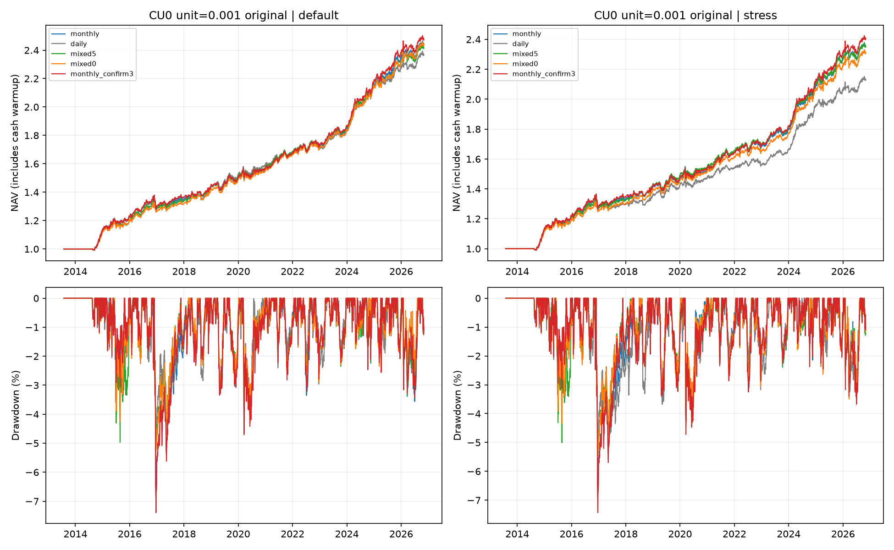
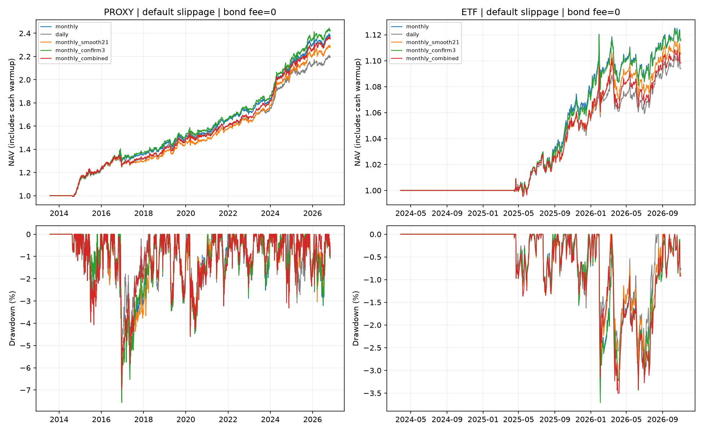

# 日频相对月频的收益损失来源，以及月频策略的改进验证

日期：2026-11-02。用户定向研究；承接[国债日频、其他资产月频研究](../../bond_daily_mixed_rebalance/20261102/report.md)。本轮同时分析“只让国债日频”与“全资产日频”，不把两者混为同一种策略。

**可以小幅优化月频策略，最有支持的是“月末趋势状态连续3个交易日确认”，而不是进一步平滑风险权重。另一个重要发现是：上一轮国债日频的长期收益差额，很大程度上被沪铜代理的最小交易单位放大，不能全部归为国债择时失败或交易成本。**

原单位代理中，国债日频5pp相对月频期末少约2.21万元，额外净交易成本仅约221元，沪铜代理贡献约1.22万元的负差额。将铜的模拟计价单位细化、保持相同收益率和完全相同理论信号后，该收益差缩至约0.48万元；国债日频0pp的差额则由约2.29万元缩至0.10万元。这个诊断修正的是原结果的解释，没有改写上一轮的实际指标。

月频3日确认在原单位/细单位两种长期模拟中均有小幅收益改善，压力滑点下仍成立；真实ETF多数起点改善，但完整窗口default收益略低且部分回撤加大。因此保留为研究候选，不称为全面优势或已验证的实盘增强。本次未改正式策略、定时任务和账户。

## 研究定义与共同口径

基线为上一轮的全资产月频版本：252日FHS-ES，95%置信度，`fhs_decay: 0.94`，至少252个收益观测，趋势过滤前预测波动上限8%，200日SMA下方将该资产权重降至25%。风险预算为股票15%、红利15%、国债30%、黄金15%、豆粕12.5%、有色12.5%。策略阈值5个百分点，执行容忍带2个百分点，20万元、空仓起步、无杠杆、现金无利息。

定时任务所用正式配置仍为 `configs/capital_100k/es_252d_fhs_stepdown_trend_200k_v2_563020_511130.yaml`，它是**全资产每日检查**。这里的“原月频”是用户要求优化的研究基线，不是声称定时任务已经切换为月频。

| 实际ETF（均为`asset_type: etf`） | 长期代理 | 长期代理的`asset_type`与限制 |
| --- | --- | --- |
| 510300 沪深300ETF | 000300 沪深300 | `index`；发布价格指数，不完整复制ETF分红和跟踪路径 |
| 563020 红利低波ETF | 000015 上证红利 | `index`；非红利低波ETF的精确选股指数 |
| 511130 30年国债ETF | CBA21801 中债30年国债财富 | `index`；非511130的精确跟踪指数 |
| 518880 黄金ETF | 仍用518880 | `etf`，保留实际ETF |
| 159985 豆粕ETF | M0 连续报价 | `futures`；缺实际换月、保证金和ETF跟踪误差 |
| 159980 有色期货ETF | CU0 沪铜连续报价 | `futures`；单一铜代理，非真实有色篮子 |

全部11个基础标的最新日期为2026-11-02，末日对齐且满足7日新鲜度要求。沿用平台Finshare、Sina与中债官方链，未覆盖基础行情。各篮子取历史报价日期交集，不把国债周末估值日作为交易日：长期代理2013-07-29—2026-11-02，共3217日；实际ETF2024-03-28—2026-11-02，共628日。

ETF信号采用后复权价格，成交/估值使用原始开盘/收盘，显式处理分红权益与支付；指数用发布价格或财富指数，期货用连续报价。CBA21801没有真实开盘，平台以当日指数收盘作执行代理。所有目标在T日收盘后形成，最早T+1执行，保留整手、费用、现金限制、挂单、拒单和交易记录。研究信号所用价格止于计算日。

国债零手续费；其他资产保持万二、最低5元。`default`普通/商品类滑点2/6bps，`stress`为10/30bps；国债仍有2/10bps滑点。费用口径与上轮一致，没有把免经手费等同为已核实的券商佣金约定。额外零费用、零滑点场景只作诊断，不属于可执行投资情景。

首次成交：长期代理2014-08-15，ETF2025-04-16。主表年化、波动和Sharpe含预热现金段；ETF建仓后只有375个交易日。敏感性采用建仓后指标。平台Sharpe为年化复合收益除以年化波动，现金无风险利率为0；不同篮子不跨样本排名。

## 一、少赚的账目：成本与持仓路径分开

所有金额均为人民币元，差值为相同篮子、相同成本下“日频方案减月频”。市场路径收益包括资产隔夜/日内涨跌、分红权益和不同持仓规模造成的后续复利反馈。它不是纯粹的择时能力估计。

`期末总资产差 = 市场路径收益差 − 手续费增量 − 滑点增量`。成本增量为负，表示该项反而节省费用。

| 篮子 | 日频方案 | 滑点 | 市场路径收益差 | 手续费增量 | 滑点增量 | 期末总资产差 |
| --- | --- | --- | ---: | ---: | ---: | ---: |
| 原单位长期代理 | 国债日频5pp | default | -21,862.61 | -125.51 | +346.18 | -22,083.28 |
| 原单位长期代理 | 国债日频5pp | stress | -21,152.78 | -98.75 | +1,846.56 | -22,900.60 |
| 原单位长期代理 | 国债日频0pp | default | -21,869.17 | -128.55 | +1,145.97 | -22,886.59 |
| 原单位长期代理 | 国债日频0pp | stress | -28,090.25 | -110.17 | +5,456.84 | -33,436.92 |
| 原单位长期代理 | 全资产日频 | default | -29,633.50 | +2,754.40 | +4,229.16 | -36,617.06 |
| 原单位长期代理 | 全资产日频 | stress | -33,579.51 | +2,687.39 | +19,647.89 | -55,914.78 |
| 实际ETF | 国债日频5pp | default | +445.40 | -4.98 | +43.36 | +407.01 |
| 实际ETF | 国债日频5pp | stress | +630.30 | -4.98 | +237.35 | +397.93 |
| 实际ETF | 国债日频0pp | default | +2,746.80 | +5.00 | +89.67 | +2,652.13 |
| 实际ETF | 国债日频0pp | stress | +3,032.90 | +5.00 | +492.33 | +2,535.57 |
| 实际ETF | 全资产日频 | default | -3,553.20 | +425.80 | +551.06 | -4,530.06 |
| 实际ETF | 全资产日频 | stress | -2,329.70 | +425.76 | +2,758.74 | -5,514.19 |

对用户原先关注的国债日频5pp，长期default终值差−22083.28元，其中市场路径差−21862.61元；手续费节省125.51元、滑点多346.18元，净额只多220.66元。手续费几乎解释不了这笔收益差。国债日频0pp的净成本增量约1017.42元，也远小于终值差。

全资产日频default终值少36617.06元：额外手续费2754.40元、滑点4229.16元，占账面差额约19.1%，其余80.9%落在市场路径。stress下直接成本占比升至约39.9%。实际ETF全日频default少4530.06元，额外成本976.86元、约21.6%；stress的成本占比约57.8%。这些比例是实际账目的分解，不能线性加回费用后冒充另一条反事实净值。

把费用与滑点全部设为零后，原单位代理的月频/日频年化仍为7.15%/6.66%，ETF为4.62%/3.81%，说明“只降手续费”没有消除损失来源。零成本会反馈到整手、现金、调仓阈值及后续持仓，因此它与简单费用加回不是同一种计算。

### 损失落在哪些资产

default下按资产归属的净收益差如下。该表与前面的成本账是两种观察方式，不能重复相加。

长期原单位代理：

| 资产 | 国债日频5pp相对月频 | 国债日频0pp相对月频 | 全资产日频相对月频 |
| --- | ---: | ---: | ---: |
| CN_INDEX:000300.SH | -3,715.98 | -7,027.97 | -6,607.24 |
| CN_INDEX:000015.SH | -656.95 | -2,523.94 | -4,147.52 |
| CN_INDEX:CBA21801.CS | -4,951.87 | -4,578.03 | -4,080.13 |
| CN_ETF:518880.SH | -990.09 | +1,863.53 | -6,433.45 |
| CN_FUTURES:M0.DCE | +400.04 | +1,728.33 | -4,101.03 |
| CN_FUTURES:CU0.SHFE | -12,168.44 | -12,348.51 | -11,247.69 |

实际ETF：

| 资产 | 国债日频5pp相对月频 | 国债日频0pp相对月频 | 全资产日频相对月频 |
| --- | ---: | ---: | ---: |
| CN_ETF:510300.SH | +0.00 | +273.74 | -378.31 |
| CN_ETF:563020.SH | -289.24 | -283.05 | -1,573.35 |
| CN_ETF:518880.SH | +0.00 | +1,860.61 | -1,341.96 |
| CN_ETF:511130.SH | +811.72 | +838.53 | +622.20 |
| CN_ETF:159985.SZ | +0.47 | +82.26 | -912.31 |
| CN_ETF:159980.SZ | -115.93 | -119.96 | -946.33 |

国债日频5pp的原单位代理负差额约55.1%落在CU0，国债自身约22.4%。月内只交易国债，依然会改变现金和组合净值，进而改变月末的持仓偏差、整组调仓触发、整手与可买数量；其他资产的理论月末信号相同，不代表它们最终持仓也相同。实际ETF中，国债日频5pp/0pp的国债自身净贡献差反而约为+812/+839元，不能照搬长期代理的单资产解释。

## 二、沪铜最小单位显著放大了长期差距

原CU0报价范围33510—112200，最小模拟单位为1。在20万元组合中，铜持仓实际只能在0与1单位之间切换，月频最大权重约20.3%。这不是细粒度的有色ETF仓位，也不是已建模的真实铜期货合约。

单位诊断只将临时快照中CU0的OHLC乘0.001、成交量乘1000，保持成交额、资产ID、`asset_type`、费率和其他数据不变，最小模拟单位仍为1。**直接共用原代理的全部理论目标与风险/趋势信号**，因此价格收益率和目标没有换策略；变化集中在整手、现金与执行残差。原始CSV未修改。该细单位不是可交易的新合约规格，只是检查表示单位依赖的研究诊断。

| 方案 | 滑点 | 年化收益 | 年化波动 | Sharpe | 最大回撤 | 年化换手 | 成交/订单/拒单 |
| --- | --- | ---: | ---: | ---: | ---: | ---: | --- |
| 原月频 | default | 7.24% | 4.38% | 1.6523 | -7.39% | 98.61% | 348/350/2 |
| 原月频 | stress | 6.93% | 4.34% | 1.5973 | -7.34% | 96.39% | 341/343/2 |
| 国债日频5pp | default | 7.16% | 4.35% | 1.6440 | -5.20% | 128.10% | 430/432/2 |
| 国债日频5pp | stress | 6.93% | 4.33% | 1.6033 | -5.44% | 125.28% | 422/424/2 |
| 国债日频0pp | default | 7.22% | 4.35% | 1.6616 | -5.29% | 178.51% | 2811/2813/2 |
| 国债日频0pp | stress | 6.78% | 4.33% | 1.5655 | -5.38% | 178.04% | 2839/2841/2 |
| 全资产日频 | default | 6.99% | 4.16% | 1.6804 | -4.66% | 234.97% | 901/901/0 |
| 全资产日频 | stress | 6.11% | 4.17% | 1.4628 | -5.27% | 236.86% | 921/921/0 |
| 月频趋势3日确认 | default | 7.36% | 4.37% | 1.6870 | -7.40% | 89.94% | 304/306/2 |
| 月频趋势3日确认 | stress | 7.12% | 4.35% | 1.6345 | -7.43% | 90.29% | 306/308/2 |

单位细化后，default国债日频5pp相对月频的年化差由约−0.40个百分点缩至−0.08个百分点，0pp差由约−0.41个百分点缩至−0.02个百分点；对应终值差约−4838.92/−1047.87元。stress中5pp与月频完整窗口收益基本相同，0pp仍落后约0.15个百分点。该变化说明旧差额高度依赖取整；不意味着真实账户可以兑现等额“修复收益”。

全资产日频在细单位default下仍低于月频年化，但Sharpe反而为1.6804，高于月频1.6523，回撤更小；stress下Sharpe仍落后。不能把原单位的一次风险调整后排序当成不变规律。

单位敏感性并未证明国债无阈值日频有稳定收益优势：细单位default/stress的0pp收益胜出仅39/71、22/71，Sharpe胜出41/71、21/71；5pp收益胜出22/71、19/71。主要取舍仍是回撤与收益、成本之间的平衡。



## 三、全资产日频：风险权重与趋势过滤各自的影响

为避免把所有差额都叫作趋势反复交易，设置四角对照：所有角都每天检查5pp阈值，只分别让风险权重、趋势乘数按日或按月更新；另以真正只在月末检查的原月频作参照。月度冻结值在首次可用信号日初始化，随后只在月末更新。

| 标识 | 风险权重更新 | 200日趋势状态更新 | 检查交易阈值 |
| --- | --- | --- | --- |
| `monthly` | 月度 | 月度 | 月末 |
| `frozen` | 月度 | 月度 | 每日 |
| `risk_monthly` | 月度 | 每日 | 每日 |
| `trend_monthly` | 每日 | 月度 | 每日 |
| `daily` | 每日 | 每日 | 每日 |

先把`frozen − monthly`记为检查节奏差额；其余风险/趋势频率交互使用两种加入次序的平均，即两因素Shapley分摊。该分摊含成本和资金路径，是本研究固定反事实下的条件贡献，不是可脱离模型解释的经济因果定律。

| 篮子 | 滑点 | 每日检查的差额 | 风险权重日频的差额 | 趋势日频的差额 | 合计 |
| --- | --- | ---: | ---: | ---: | ---: |
| 原单位长期代理 | default | -3,380.71 | -21,503.46 | -11,732.88 | -36,617.06 |
| 原单位长期代理 | stress | -2,485.22 | -26,393.95 | -27,035.61 | -55,914.78 |
| 实际ETF | default | +776.37 | +1,401.85 | -6,708.27 | -4,530.06 |
| 实际ETF | stress | +766.48 | +1,493.94 | -7,774.61 | -5,514.19 |

长期原单位default的风险权重日频分摊约−2.15万元，趋势日频约−1.17万元；不是只有趋势过滤造成损失。ETF短样本则表现为趋势日频约−6708元，抵消了风险权重日频约+1402元和检查节奏约+776元。两套资产和市场环境不同，不宜据此统一加快或减慢全部信号。

原单位长期default全日频有456次“同资产连续两笔成交方向相反、间隔不超过10个交易日”的记录，月频2次；ETF为73次与0次。这只是频繁反向交易的描述，不等同每笔都实现亏损，亦不作为独立的因果证明。

## 四、保持月频的三个固定改进规则

以下规则在本轮候选计算前固定，没有搜索窗口网格：

1. `monthly_confirm3`：只在月末检查。逐资产查看最近3个交易日各自的200日SMA趋势状态；三天都一致才切换到新状态，否则保持上月已确认状态。首次建仓沿用当日状态。仍是月末信号、T+1执行，没有增加月内交易，也没有把确认日提前使用。
2. `monthly_smooth21`：将最近最多21个有效交易日的**趋势过滤前风险权重**取均值，再按当日252日协方差将趋势过滤前预测波动限制在8%以内，最后乘当前月末趋势。预热起点不借用运行窗口以前的权重；最初不足21个可用估计时只取已有估计。
3. `monthly_combined`：同时采用上述两项。

3日和21日是本次提出的固定研究常数，不声称最优参数。平滑权重后不再精确满足当日的ES风险贡献比例；波动限制也不是实现波动或回撤保证。原交易阈值、整手、费率、月频及风险预算输入均保持。

长期原单位结果：

| 方案 | 滑点 | 年化收益 | 年化波动 | Sharpe | 最大回撤 | 年化换手 | 成交/订单/拒单 |
| --- | --- | ---: | ---: | ---: | ---: | ---: | --- |
| 原月频 | default | 7.03% | 4.32% | 1.6276 | -7.45% | 105.74% | 330/332/2 |
| 原月频 | stress | 6.81% | 4.31% | 1.5805 | -7.39% | 105.30% | 331/333/2 |
| 月频趋势3日确认 | default | 7.19% | 4.31% | 1.6666 | -7.57% | 97.91% | 302/304/2 |
| 月频趋势3日确认 | stress | 6.95% | 4.32% | 1.6088 | -7.50% | 97.08% | 302/304/2 |
| 月频风险权重21日均值 | default | 6.69% | 4.33% | 1.5436 | -7.06% | 89.32% | 295/296/1 |
| 月频风险权重21日均值 | stress | 6.50% | 4.33% | 1.5027 | -7.17% | 91.16% | 292/293/1 |
| 月频两项组合 | default | 6.95% | 4.30% | 1.6164 | -6.97% | 83.53% | 268/269/1 |
| 月频两项组合 | stress | 6.78% | 4.28% | 1.5826 | -7.08% | 80.10% | 261/262/1 |

实际ETF结果：

| 方案 | 滑点 | 年化收益 | 年化波动 | Sharpe | 最大回撤 | 年化换手 | 成交/订单/拒单 |
| --- | --- | ---: | ---: | ---: | ---: | ---: | --- |
| 原月频 | default | 4.53% | 4.06% | 1.1146 | -3.65% | 83.96% | 48/49/1 |
| 原月频 | stress | 4.24% | 4.03% | 1.0510 | -3.61% | 82.28% | 47/48/1 |
| 月频趋势3日确认 | default | 4.48% | 4.09% | 1.0971 | -3.71% | 73.62% | 38/39/1 |
| 月频趋势3日确认 | stress | 4.30% | 4.09% | 1.0512 | -3.74% | 75.85% | 41/42/1 |
| 月频风险权重21日均值 | default | 4.12% | 3.98% | 1.0343 | -3.47% | 73.96% | 42/42/0 |
| 月频风险权重21日均值 | stress | 3.89% | 3.99% | 0.9748 | -3.52% | 76.82% | 45/45/0 |
| 月频两项组合 | default | 3.84% | 4.00% | 0.9616 | -3.51% | 60.01% | 35/35/0 |
| 月频两项组合 | stress | 3.66% | 4.02% | 0.9109 | -3.55% | 59.97% | 35/35/0 |

3日确认在原单位长期default/stress年化提高约0.16/0.13个百分点，Sharpe改善、成交330/331笔降至302/302笔，完整样本回撤略扩大。细单位下仍提高约0.12/0.18个百分点；default的净增收益约7137.65元，其中市场路径改善约6628.39元、交易成本节省约509.26元，收益不只是省掉几笔最低佣金。

ETF完整窗口default反而少约232.32元、年化约低0.04个百分点；stress年化约高0.07个百分点，回撤均略扩大。它有改进潜力，但没有跨篮子、跨指标的全面优势。21日风险权重均值和两项组合未显示稳定增益，本轮不继续扩展参数尝试。



## 五、每两个自然月的起点验证

各篮子从共同首日生成双月锚点，取锚点当日或之后首个共同交易日，统一终点2026-11-02。每个起点独立预热252个收益、不继承持仓；仅在双方建仓后至少126日时展示稳健性胜出，长期各80个运行起点中71个有效，ETF16个中7个有效。短历史/无成交场景仍执行并保留指标。

表中差值与胜出均相对同一篮子、同一起点和同一滑点的原月频；“差值的中位数”不是两组中位数之差。相邻窗口高度重叠，不是独立统计样本；完整窗口与首个敏感性起点也可能重复，不把任务数量当作独立证据数量。

重点候选：

| 篮子 | 方案 | 滑点 | 有效起点 | 配对建仓后年化差中位数 | 配对Sharpe差中位数 | 收益胜出 | Sharpe胜出 | 回撤改善 |
| --- | --- | --- | ---: | ---: | ---: | ---: | ---: | ---: |
| 原单位长期代理 | 月频趋势3日确认 | default | 71 | +0.181个百分点 | +0.0556 | 65/71 | 65/71 | 36/71 |
| 原单位长期代理 | 月频趋势3日确认 | stress | 71 | +0.210个百分点 | +0.0670 | 66/71 | 65/71 | 38/71 |
| CU0细单位诊断 | 月频趋势3日确认 | default | 71 | +0.181个百分点 | +0.0372 | 63/71 | 62/71 | 25/71 |
| CU0细单位诊断 | 月频趋势3日确认 | stress | 71 | +0.198个百分点 | +0.0390 | 65/71 | 62/71 | 28/71 |
| 实际ETF | 月频趋势3日确认 | default | 7 | +0.172个百分点 | +0.0166 | 6/7 | 5/7 | 1/7 |
| 实际ETF | 月频趋势3日确认 | stress | 7 | +0.242个百分点 | +0.0296 | 7/7 | 7/7 | 1/7 |

其他月频改法：

| 篮子 | 方案 | 滑点 | 有效起点 | 配对建仓后年化差中位数 | 配对Sharpe差中位数 | 收益胜出 | Sharpe胜出 | 回撤改善 |
| --- | --- | --- | ---: | ---: | ---: | ---: | ---: | ---: |
| 原单位长期代理 | 月频风险权重21日均值 | default | 71 | -0.138个百分点 | -0.0632 | 29/71 | 14/71 | 43/71 |
| 原单位长期代理 | 月频风险权重21日均值 | stress | 71 | -0.092个百分点 | -0.0528 | 29/71 | 19/71 | 45/71 |
| 原单位长期代理 | 月频两项组合 | default | 71 | +0.068个百分点 | -0.0116 | 38/71 | 27/71 | 43/71 |
| 原单位长期代理 | 月频两项组合 | stress | 71 | +0.099个百分点 | -0.0034 | 42/71 | 32/71 | 45/71 |
| 实际ETF | 月频风险权重21日均值 | default | 7 | -0.131个百分点 | -0.0148 | 3/7 | 2/7 | 4/7 |
| 实际ETF | 月频风险权重21日均值 | stress | 7 | -0.007个百分点 | -0.0109 | 3/7 | 3/7 | 4/7 |
| 实际ETF | 月频两项组合 | default | 7 | -0.123个百分点 | -0.0105 | 2/7 | 2/7 | 4/7 |
| 实际ETF | 月频两项组合 | stress | 7 | -0.095个百分点 | -0.0063 | 3/7 | 3/7 | 4/7 |

3日确认在原单位default/stress收益胜出65/71、66/71，Sharpe均65/71；细单位仍63/71、65/71，Sharpe均62/71，说明收益改善并非完全由粗单位偶然产生。其配对建仓后年化改善中位数约0.18—0.21个百分点。

但细单位只有25/71、28/71个起点最大回撤改善，其余多为持平或更差。ETF收益在6/7、7/7个有效起点改善；default完整窗口仍是反例。这更适合视为“少做月末边界附近的趋势切换”的小幅优化方向，而不是同时提高收益、降低回撤的保证。

## 六、可采用的结论与尚存限制

研究上可优先保留**月频＋3日趋势确认**，不增加调仓频率；21日风险权重均值与组合规则本轮不保留为改进建议。用户若优先追求回撤而非收益，可继续比较国债日频混合方案，但不能用原先粗单位造成的收益差否定它，也不能把细单位模拟包装成真实可交易的铜仓位。

本轮仍属用户指定方向的探索验证，没有自主候选接受、收益阈值或训练/最终测试切分，也没有新的独立市场样本。真实ETF建仓历史短、代理并不精确对应实际ETF、连续期货缺真实换月/保证金、指数不可直接交易等限制仍在。平均现金含预热段；挂单压力、现金权重、费用、跳过单和每项完整指标保存在证据附件，不把高现金都解释成策略建仓后的拖累。

## 数据版本、实现与复现

原始数据版本为2026-11-02，基础文件逐一SHA-256、正式源配置指纹及源代码指纹见[evidence.json](evidence.json)。HEAD为`50b7f945e531e32ad49ce9cf286b54d4a13cf01a`；新增研究脚本位于本工作区，不能仅凭HEAD代替工作区代码身份。Python 3.12.14；NumPy 2.3.5、pandas 3.0.1、SciPy 1.18.1、PyYAML 6.0.3、Finshare 2.1.0、AKShare 1.20.2。

研究类仅在复现进程内注册，沿用平台`Strategy.generate_targets(context)`、原始执行器和此前的国债零费研究状态。没有向正式`BUILTIN_STRATEGIES`代码或正式配置加入候选。

逐日账目使用：前日份额乘“当日开盘减前收盘”的隔夜收益，加当日收盘份额乘“当日收盘减开盘”的日内收益，加除息日确认的分红权益，减实际手续费和成交价相对估值价的滑点。含持仓的份额拆分会明确拒绝未支持的归因；本次样本没有此类事件。各完整场景逐日与包含应收分红的账户净值对账，最大残差2.561e-10元。

所有成交断言信号日在成交日以前，国债手续费为0，月频/混合方案非国债信号来自月末或首次建仓。绩效直接读取实际`manifest.json`中的`metrics`。共2392项不同场景：基础矩阵1580项、铜单位诊断812项；其中56个完整窗口、2336个双月起点场景。另对最终冻结入口的全部56个完整窗口实际重算，配对指标一致；最终19项独立/历史基线校验通过，其中3项禁用信号与分量缓存重算、16项对照上轮实存指标，最大指标差2.842e-14，成交/订单/拒单数一致。

基础矩阵在补充单位诊断前执行，其源指纹单独保存在`execution_batches`；新增诊断未改变已运行的策略分支，最终冻结入口的56个整窗重算再次核对了全部篮子和模式。敏感性按实际执行批次保留来源，不伪称每个历史批次都使用同一个脚本指纹。

从仓库根目录一次生成全部研究输入、信号、2392项矩阵、逐资产/年度归因、汇总、独立校验与两张图：

```powershell
.\env\Scripts\python.exe platform/reports/monthly_frequency_attribution/20261102/reproduce.py --workers 8 --verify
```

`--phase base`可只检查整窗，`--phase units`可独立重建单位诊断，两者均重新检查源行情，不依赖上次中间结果。基础数据过期或末日不齐时停止。历史基线校验针对本报告的样本与指纹；数据修订或窗口变化后，应将运行视为新研究并重新核对，不能冒称旧指标逐字复现。

实际发布先完成基础矩阵，再增加单位诊断并运行冻结整窗校验；最终证据合并2392项不同场景，保留3批来源和56项冻结重算差值。默认完整入口可一次重建同一矩阵。运行配置、数据快照、明细CSV与日志只在`platform/results/monthly_frequency_attribution/`及`platform/results/configs/monthly_frequency_attribution/`临时生成；验证后清理。最终保留本报告、[可执行复现入口](reproduce.py)、必要图表和完整指标证据，不归档中间文件。
